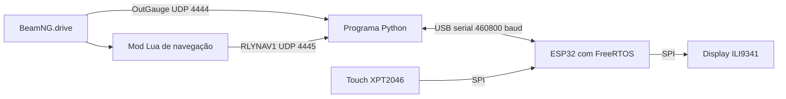

# Visor Rally ESP32

Painel físico com ESP32 e display touch para acompanhar instrumentos e navegação no **BeamNG.drive**.

A interface tem duas páginas: uma mostra os dados do carro; a outra apresenta um minimapa desenhado a partir da rede de estradas e da rota ativa do jogo. A troca entre elas é feita por arrasto ou pelos botões na tela.

**O minimapa utiliza dados nativos do BeamNG. Não depende de capturar o monitor nem de manter o mapa do jogo visível.**

Projeto desenvolvido para a disciplina de **Sistemas Embarcados**, da Universidade Federal da Grande Dourados — UFGD.

## Funcionalidades

### Página de instrumentos

- Velocidade em km/h, RPM e marcha, incluindo neutro e ré.
- Combustível em porcentagem.
- Pressão do turbo em bar, com barra e escala configurável.
- Ícone de ABS conforme o sinal disponibilizado pelo veículo.
- Aviso **SHIFT** piscando para indicar a troca de marcha.

O SHIFT utiliza o sinal do jogo quando disponível. Caso contrário, utiliza um limite de apoio de 6500 RPM. Esse limite pode ser substituído manualmente para corresponder ao carro utilizado.

### Página de navegação

- Estradas próximas em cinza, rota em laranja e marcador do carro em azul.
- Mapa orientado com a frente do veículo voltada para cima.
- Distância restante da rota, quando disponível.
- Alcance visual configurável pelo programa do PC.
- Modo de demonstração com rota fictícia, sem precisar abrir o jogo.

## Como funciona



O computador recebe a telemetria, converte os valores e desenha o minimapa. O ESP32 recebe os quadros pela USB, valida o conteúdo, decodifica as imagens e processa o touch.

Os pacotes UDP circulam no próprio computador, em `127.0.0.1`. A comunicação com o ESP32 utiliza **USB**, sem exigir Wi-Fi.

| Caminho | Formato | Configuração padrão |
| --- | --- | --- |
| Jogo → Python | OutGauge binário | UDP `127.0.0.1:4444` |
| Mod Lua → Python | JSON com identificação `RLYNAV1` | UDP `127.0.0.1:4445` |
| Python ↔ ESP32 | Quadros `RLY1` com tipo, tamanho e CRC32 | USB serial, 460800 baud |
| ESP32 ↔ display e touch | SPI com seleções CS separadas | Pinagem abaixo |

## Hardware

- Placa de desenvolvimento ESP32.
- Display TFT de **2,4 polegadas**, **320 × 240 pixels**, com controlador **ILI9341**.
- Touch resistivo SPI compatível com **XPT2046**.
- Cabo USB de dados e fios de conexão.
- Computador com Windows e BeamNG.drive para utilizar os dados reais.

### Pinagem do protótipo

| Sinal | GPIO do ESP32 |
| --- | --- |
| SCK do display e T_CLK do touch | 18 |
| MOSI/SDI do display e T_DIN do touch | 23 |
| MISO/SDO do display e T_DO do touch | 19 |
| CS do display | 5 |
| DC do display | 2 |
| RESET do display | 4 |
| T_CS do touch | 22 |
| T_IRQ | Não conectado; configurado como `-1` |
| GND | GND comum |

O ESP32 é alimentado pela USB. A alimentação do módulo de display deve seguir a especificação de sua placa adaptadora. Os sinais dos GPIOs do ESP32 utilizam lógica de 3,3 V.

O firmware utiliza `setRotation(3)`. A calibração do touch corresponde ao protótipo testado; outros módulos ou orientações podem exigir recalibração.

## Instalação

### 1. Enviar o firmware ao ESP32

No Arduino IDE:

1. Instale o pacote de placas **esp32**, da Espressif Systems.
2. Instale as bibliotecas **Adafruit GFX Library**, **Adafruit ILI9341**, **XPT2046_Touchscreen** e **TJpg_Decoder**.
3. Abra [`beamng_rally/beamng_rally.ino`](beamng_rally/beamng_rally.ino).
4. Selecione a placa e sua porta serial e envie o código.
5. Feche o Monitor Serial para liberar a porta ao programa Python.

O protótipo foi compilado com Arduino-ESP32 **3.3.7** e validado em um ESP32 clássico. A configuração de placa precisa corresponder ao hardware utilizado.

### 2. Preparar o programa Python

Abra um terminal na raiz deste repositório e execute:

```powershell
python -m pip install -r requirements.txt
```

As dependências são **pySerial** e **Pillow**. Os demais módulos Python necessários acompanham o repositório.

### 3. Instalar o mod de navegação

Abra a pasta de usuário pelo launcher do BeamNG e, dentro de `mods/unpacked`, crie a pasta `visor_rally_nativo`.

Copie para ela **o conteúdo** de [`mod_visor_rally_nativo/`](mod_visor_rally_nativo/), mantendo esta estrutura:

```text
mods/unpacked/visor_rally_nativo/
├── lua/ge/extensions/visorRallyNav.lua
├── scripts/visorRallyNav/modScript.lua
└── mod_info/visor_rally_nativo/info.json
```

Na instalação Windows utilizada no desenvolvimento, a pasta fica em:

```text
%LOCALAPPDATA%/BeamNG/BeamNG.drive/current/mods/unpacked/visor_rally_nativo/
```

Reinicie o jogo após instalar o mod. A extensão é carregada pelo `modScript.lua` e envia os dados de navegação pela porta UDP **4445**, com intervalo configurado de 0,2 segundo.

### 4. Configurar o BeamNG

1. Ative **OutGauge UDP protocol** em **Options → Other → Protocols**.
2. Configure o destino como **IP `127.0.0.1`**, **porta `4444`**.
3. Entre em um mapa e em um carro.
4. Defina um destino pelo mapa do jogo para ter uma rota destacada no visor.

Os nomes e a posição das opções podem variar conforme a versão e o idioma do jogo. A integração foi validada com **BeamNG.drive 0.40.4.0**, em Windows.

## Executar

```powershell
python beamng_rally_nativo.py --porta COM6
```

Substitua `COM6` pela porta exibida para a sua placa no Arduino IDE. Mantenha apenas um programa usando essa porta por vez. Para encerrar e liberar a conexão, pressione **Ctrl+C** no terminal.

### Controles da tela

| Ação | Resultado |
| --- | --- |
| Arrastar para a esquerda na página 1 | Abre o minimapa |
| Arrastar para a direita na página 2 | Volta aos instrumentos |
| Tocar em PAINEL ou MINIMAPA no rodapé | Abre a página escolhida |

### Testar sem abrir o jogo

```powershell
python beamng_rally_nativo.py --porta COM6 --demo
```

Arraste para a esquerda. A página 2 exibirá uma rota fictícia em movimento, identificada como **DEMONSTRAÇÃO**. A página 1 continua dependendo da telemetria real do jogo.

### Ajustar o visor ao carro

```powershell
python beamng_rally_nativo.py --porta COM6 --shift-rpm 6200 --rpm-max 8000 --turbo-max 3 --alcance 250
```

| Parâmetro | Padrão | Função |
| --- | --- | --- |
| `--porta` | `COM6` | Porta USB serial do ESP32 |
| `--udp-porta` | `4444` | Porta de recepção do OutGauge |
| `--nav-porta` | `4445` | Porta de recepção do mod de navegação |
| `--shift-rpm` | Automático ou 6500 RPM | Quando informado, força um limite manual de SHIFT |
| `--rpm-max` | `8000` | Limite visual da escala do conta-giros |
| `--turbo-max` | `2` | Limite visual da barra de turbo, em bar |
| `--alcance` | `400` | Altura aproximada da área visível do minimapa, em metros |
| `--qualidade` | `65` | Qualidade JPEG, entre 20 e 90 |
| `--demo` | Desativado | Exibe a rota fictícia de demonstração |
| `--diagnostico` | Desativado | Mostra a recepção da navegação no terminal, sem abrir a USB |

As escalas visuais não alteram o motor do veículo. O RPM de troca deve ser escolhido para o carro utilizado. Se alterar uma porta UDP, ajuste também o emissor correspondente: as opções do jogo para OutGauge ou a variável `port` no mod Lua para navegação.

## Firmware e FreeRTOS

| Tarefa | Prioridade | Responsabilidade |
| --- | --- | --- |
| `SerialRX` | 2 | Solicitar e receber quadros; verificar tamanho e CRC32 |
| `loopTask` | 1 | Ler o touch, reconhecer gestos, desenhar os instrumentos e decodificar o mapa |

- Uma fila leva a página selecionada até a tarefa de recepção.
- Outra fila entrega o descritor do quadro à interface.
- Um semáforo binário impede a reutilização do buffer enquanto a interface o lê.
- Display e touch são acessados pela mesma tarefa, evitando disputa pelo SPI.
- O firmware utiliza `vTaskDelay()` e `millis()`, sem `delay()`.
- O mostrador é alocado após a inicialização do ambiente Arduino, evitando a falha de memória encontrada durante o desenvolvimento.

O computador desenha o mapa em **320 × 208 pixels** e envia JPEG. Os **32 pixels inferiores** ficam reservados para a navegação entre páginas. O transporte permite quadros de até **50 000 bytes**.

## Arquivos principais

```text
.
├── beamng_rally/beamng_rally.ino   # Firmware do ESP32
├── beamng_rally_nativo.py          # Aplicação principal no PC
├── beamng_serial.py                # Leitura OutGauge e lógica de SHIFT
├── beamng_dados.py                 # Recepção contínua da telemetria
├── beamng_mapa_nativo.py           # Recepção da navegação e desenho do mapa
├── visor_serial.py                # USB, enquadramento, CRC32 e JPEG
├── mod_visor_rally_nativo/         # Código do mod Lua
└── requirements.txt               # Dependências Python
```

A pasta `plugin_telemetria/` pertence aos experimentos anteriores com ETS2 e não é necessária à versão BeamNG.

## Solução de problemas

| Sintoma | O que verificar |
| --- | --- |
| Erro ao abrir a COM6 | Confirme a porta e feche o Monitor Serial ou outro programa que esteja usando a placa |
| Sem resposta do PC | Confira se o programa Python está rodando e se o firmware enviado é `beamng_rally`, a 460800 baud |
| Sem dados do carro | Confirme OutGauge ativo, IP, porta e veículo carregado |
| Aguardando navegação | Confirme a instalação e ativação do mod e reinicie o jogo |
| Estradas aparecem, mas a rota não | Defina um destino no jogo; algumas missões usam outros sistemas de rota |
| Touch com posições incorretas | Refaça a calibração para o módulo e a orientação utilizados |
| Porta UDP ocupada | Encerre outro receptor da mesma porta ou ajuste o emissor e o receptor para outra porta |

Para conferir a navegação sem usar a USB:

```powershell
python beamng_rally_nativo.py --diagnostico
```

O terminal informa o estado do mod e a quantidade de estradas e pontos de rota recebidos. Encerre esse diagnóstico antes de abrir outro receptor na porta 4445.

Se necessário, a extensão também pode ser carregada pelo console **Game Engine Lua**:

```lua
extensions.load('visorRallyNav')
```

## Limitações

- O mapa é esquemático e utiliza o grafo de navegação do jogo, sem texturas de terreno.
- A rota é obtida de `core_groundMarkers`; algumas missões e trilhas podem usar outro sistema.
- Sem destino definido, o visor apresenta as estradas locais e o marcador do carro.
- O sinal ABS pode representar atuação ou desativação do sistema, conforme o jogo; o ícone não distingue essas situações sozinho.
- O SHIFT e a disponibilidade de turbo dependem dos dados do veículo utilizado.
- Não são gerados avisos de copiloto, como classificação de curvas ou instruções por voz.
- O sistema depende do computador; o ESP32 não executa o simulador nem calcula a rota completa.

## Documentação

- [Relatório do projeto](Relatorio_Projeto_Visor_Rally_ESP32.pdf)
- [Protocolos de integração do BeamNG](https://documentation.beamng.com/modding/protocols/)
- [Rede de navegação do BeamNG](https://documentation.beamng.com/modding/levels/level_formats/map/)
- [FreeRTOS no ESP32](https://docs.espressif.com/projects/esp-idf/en/stable/esp32/api-reference/system/freertos_idf.html)
- [TJpg_Decoder](https://github.com/Bodmer/TJpg_Decoder)
